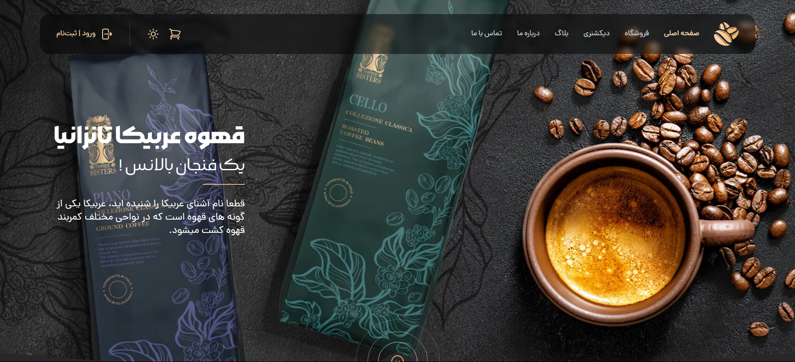
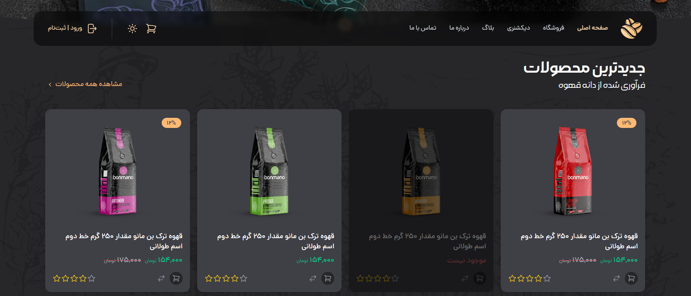
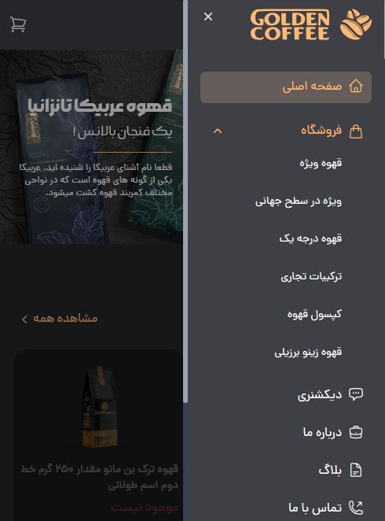
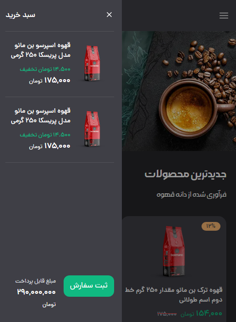

# Coffee Template

Responsive coffee shop landing page template.

## Live Demo
https://coffee-template-rho.vercel.app/

## Screenshots



<p>
  
  
</p>

## Features
- Responsive layout
- Clean landing sections (Hero, Features, CTA)
- Easy to customize

## Tech Stack
- HTML/CSS/JS (update if you used React/Tailwind)

## Run locally
Check `package.json` scripts, usually:
```bash
npm install
npm run dev
